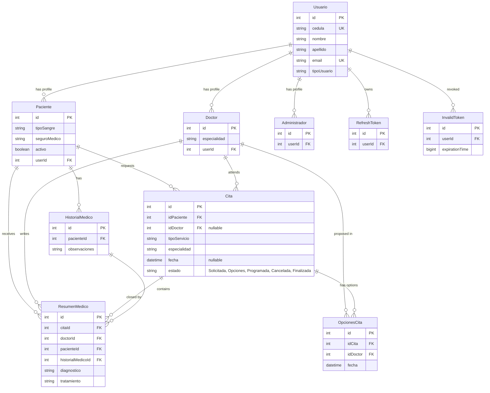

# Clinica (clinic management platform)

## At a glance

| Field             | Value                                                                                                                                                                                                     |
| ----------------- | --------------------------------------------------------------------------------------------------------------------------------------------------------------------------------------------------------- |
| Type              | Full-stack web application (React SPA + REST API), three roles (patient, doctor, administrator)                                                                                                           |
| Context           | Academic project (the author prefers not to mention that it was a thesis). It was the case study of a real clinic in Maturín, Venezuela, Clínica INMECA; the name may be shown. General clinic management |
| Author's role     | Project lead; backend architecture and implementation; database design; system design; adjusted endpoints to the frontend's needs (author)                                                                |
| Status            | Functional prototype. Never deployed, only demoed locally. No users, no results (author)                                                                                                                  |
| Repos             | [Clinica-Backend](https://github.com/Dava2310/Clinica-Backend), [Clinica-Frontend](https://github.com/Dava2310/Clinica-Frontend) (both public)                                                            |
| Period            | Git: 2024-11-16 to 2025-06-25 (about 7 months span, 28 distinct commit days). Backend commits stop 2025-05-16; the only frontend commit by Daniel is 2025-06-25                                           |
| Effort estimate   | Author: about 60 h of his own time, including database design and system design. Git-based (all authors, commit clustering): about 38 h combined                                                          |
| Contributors/team | 2 people: Daniel Vetencourt (Dava2310) and Manuel Blanco (git shows him as "mvblanco99" and "Manuel Blanco")                                                                                              |
| Outcome           | None stated. No grade, no users, no deployment                                                                                                                                                            |

## Summary

Clinica is a web platform for managing a general clinic. Patients request appointments, an administrator proposes doctor and date options, the patient picks one, and after the visit the doctor closes it with a medical summary stored in the patient's history. It is a React front end over a Node.js/Express REST API with a MySQL database modelled in Prisma. It was built by a team of two as an academic project, around the needs of a real clinic in Maturín, Venezuela (Clínica INMECA), and demoed locally.

## The problem and the idea

A clinic needs one place to organise who sees which doctor and when, and to keep a record of what happened in each visit. In the author's framing it is a general clinic-management system (not tied to a real clinic). The core idea is a negotiated appointment: the patient does not choose a slot directly; the administrator (acting as receptionist) offers options with a doctor, and the patient confirms. Each finished visit becomes a medical summary attached to the patient's medical history. A PDF report was planned but not delivered (only a pdfkit stub exists).

## Impact highlights

### 1. A relational model of the whole clinic workflow, evolved through 8 migrations

- **What it is:** A 10-model MySQL schema covering users, the three role profiles, appointments, proposed appointment options, medical histories and medical summaries, plus token tables for sessions.
- **Why it matters:** The design separates identity (`Usuario`) from role profiles (`Paciente`, `Doctor`, `Administrador`) and links every medical summary to four things at once: appointment, patient, doctor and the patient's history. The "proposed options" are their own table (`OpcionesCita`: doctor + date per appointment) instead of columns on the appointment, which is what makes the propose-then-choose flow possible. Unique constraints on `cedula` and `email`. This is the part the author owns end to end (database and system design).
- **Evidence:** `Clinica-Backend/prisma/schema.prisma` (158 lines, 10 models); `prisma/migrations/` (8 migrations: `20241116151329_principal`, `20241203011201_citas`, `20241214184224_nueva_cita`, `20241218225610_opciones_cita`, `20250517012054_pacientes_estado`, etc.) show the schema growing with the features (counted with `ls`).
- **How to say it (EN):** I designed the relational schema for the clinic: 10 Prisma models covering users, role profiles, appointments, proposed date options and medical records, evolved through 8 migrations.
- **Como decirlo (ES):** Diseñé el esquema relacional de la clínica: 10 modelos de Prisma para usuarios, perfiles por rol, citas, opciones de fecha propuestas y registros médicos, con 8 migraciones.

### 2. A negotiated appointment lifecycle with a proposal step

- **What it is:** An appointment moves Solicitada -&gt; Opciones -&gt; Programada -&gt; Finalizada, with Cancelada as an exit. The patient requests (service type and specialty), the admin proposes doctor and dates, the patient approves one (doctor and date are written to the appointment), the doctor finishes it by writing the summary.
- **Why it matters:** It models a real reception workflow rather than a simple booking form. Proposing options writes all option rows and flips the state in one database transaction (`crearOpciones` in `citas.controller.js`, using `prisma.$transaction`). Finishing is tied to the summary: `createResumen` in `resumenMedico.controller.js` creates the summary linked to the patient's history and sets the appointment to Finalizada. Guards: cannot reassign a doctor on a Programada appointment (409), cannot cancel a finished one, cannot delete finished ones so history stays.
- **Honest limits (do not oversell):** there is NO conflict prevention. The code has `// TODO: Verificar la incompantiblidad con las horas` in `createCita`; two appointments can be given to the same doctor at the same time. Transitions are only partly enforced (for example `finalizarCita` and `cancelarCita` do not check the current state fully; `createResumen` updates the state outside a transaction; `deleteCita` checks a state "Asignada" that is never set). Present this as a working lifecycle, not as a scheduling engine.
- **Evidence:** `src/controllers/citas.controller.js` (526 lines, 12 handlers: `createCita`, `crearOpciones`, `asignarDoctor`, `cancelarCita`, `finalizarCita`, `deleteCita`...); `src/routes/citas.routes.js`; `Cita.estado` in `schema.prisma`; frontend `modules/patients/pages/ApproveAppointmentPage.tsx`, `modules/doctors/pages/EndAppointmentPage.tsx`, `modules/administrator/pages/AppointmentsPage.tsx` (panels per state).
- **How to say it (EN):** I modelled the appointment as a lifecycle (requested, options proposed, scheduled, finished or cancelled), where the admin proposes doctor and date options in a single transaction and the patient picks one.
- **Como decirlo (ES):** Modelé la cita como un ciclo de vida (solicitada, con opciones, programada, finalizada o cancelada), donde el administrador propone opciones de doctor y fecha en una sola transacción y el paciente elige una.

### 3. Atomic registration with role-specific profiles and an automatic medical history

- **What it is:** One register endpoint creates the user, the matching role profile (patient, doctor or administrator) and, for patients, an empty medical history, all inside one transaction.
- **Why it matters:** No half-created accounts: if the profile or history fails, the user is rolled back. Validation is conditional by role with Joi (a doctor must give specialty and phone; a patient blood type, address, phone and insurance), the password policy requires 8+ characters with upper, lower, digit and symbol, passwords are hashed with bcrypt, and duplicate email or cedula return 409.
- **Evidence:** `src/controllers/auth.controller.js` (`registerUser`, `prisma.$transaction`), `src/validations/userValidation.js` (`userRegister`, `pacienteRegister`, `doctorRegister`), tests in `test/auth/01_auth.spec.js` (admin, doctor, patient registration, duplicate email, duplicate cedula).
- **How to say it (EN):** Registration creates the user, the role profile and the patient's medical history in one transaction, with role-specific Joi validation and hashed passwords.
- **Como decirlo (ES):** El registro crea el usuario, el perfil del rol y el historial médico del paciente en una sola transacción, con validación Joi según el rol y contraseñas con hash.

### 4. Session handling: access and refresh tokens, rotation, logout blacklist, soft delete

- **What it is:** Login returns a 1-hour access token and a 1-week refresh token. Refreshing deletes the old refresh token from the database and issues a new pair (rotation). Logout stores the access token in a blacklist table that the auth middleware checks. Deactivated patients cannot log in, and get the same generic "invalid email or password" message as a wrong password.
- **Why it matters:** Beyond a basic JWT login: revocable sessions and no user-enumeration hint. Patients are never hard-deleted by the admin flow (flag `activo = false`), so their clinical history survives, which is the right call for medical records.
- **Evidence:** `auth.controller.js` (`loginUser`, `refreshToken`, `logoutUser`), `src/middleware/auth.js` (`ensureAuthenticated` checks `invalidToken` then `jwt.verify`, distinguishes expired from invalid with codes `AccessTokenExpired` / `AccessTokenInvalid`), `pacientes.controller.js` (`deletePaciente`), migration `20250517012054_pacientes_estado`.
- **How to say it (EN):** Authentication uses short-lived access tokens, rotating refresh tokens and a logout blacklist; patients are soft-deleted so their medical history is preserved.
- **Como decirlo (ES):** La autenticación usa tokens de acceso de corta duración, refresh tokens rotativos y lista negra al cerrar sesión; los pacientes se eliminan de forma lógica para conservar su historial médico.

### 5. Three role-based portals delivered end to end, led by the author

- **What it is:** A complete system with about 45 REST endpoints and a React front end of about 7,400 lines (TypeScript/TSX) with separate modules for patient, doctor and administrator, built by two people with the author leading and shaping the API for the front end.
- **Why it matters:** Shows project leadership and API design in a team: the author defined the architecture and then adapted endpoints to what the frontend needed (e.g. `getOpciones` refactor, route reorganisations for citas by doctor and by patient). The frontend guards each portal by URL prefix per role and keeps the session in a cookie.
- **Evidence:** Endpoints counted in `Clinica-Backend/src/routes/*.js` (auth 6, users 5, doctors 5, patients 4, appointments 12, histories 4, summaries 9 = 45). Frontend: 51 `.tsx` files; 7,367 lines of `.ts/.tsx` (`git ls-files` + `wc -l`, excluding lock files); `src/routes/ProtectedRoute.tsx`; commits `b541bc7` (restructure citas routes), `51cfe65` (refactor getOpciones), `bbada29`, `a5c5901` (routes by doctor and patient). Backend line ownership by `git blame`: 4,438 of 4,592 lines (97%) by Dava2310.
- **How to say it (EN):** I led a two-person team and built the backend and database for a three-role clinic system (about 45 endpoints), adapting the API as the React front end evolved.
- **Como decirlo (ES):** Lideré un equipo de dos personas y construí el backend y la base de datos de un sistema clínico con tres roles (unos 45 endpoints), adaptando la API a medida que evolucionaba el frontend en React.

### 6. Integration tests against a real database and Swagger for the auth module (modest)

- **What it is:** 17 active Jest + supertest integration tests that call the real Express app and a real MySQL (register for 3 roles, duplicates, login ok/fail, logout, patients get/edit, doctors get/edit/delete), run in a fixed file order through a custom sequencer so later suites reuse the admin created by the first one. Swagger UI at `/api-docs` documents the 6 auth endpoints.
- **Why it matters:** Tests hit the whole stack, not mocks. But coverage is narrow: nothing for appointments, histories or summaries, and 2 patient-delete tests are commented out. Feature as supporting evidence only.
- **Evidence:** `test/auth/01_auth.spec.js`, `02_paciente.spec.js`, `03_doctor.spec.js`, `test/testSequencer.cjs` (counted `test(` occurrences, excluding commented ones); `src/swagger.js` and `@swagger` blocks (6, all in `src/routes/auth.routes.js`, 577 lines).
- **How to say it (EN):** The API has Jest and supertest integration tests that run against a real database for the auth, patient and doctor modules, plus Swagger docs for authentication.
- **Como decirlo (ES):** La API tiene pruebas de integración con Jest y supertest contra una base de datos real para los módulos de autenticación, pacientes y doctores, y documentación Swagger de autenticación.

## What the author built (role and ownership)

- **Daniel (project lead):** system design, database design (Prisma schema and migrations), backend architecture and almost all backend code: auth module, users, patients, doctors, appointments, medical histories, medical summaries, Swagger for auth, tests, and the patient soft delete. Adjusted endpoints to the frontend's needs. Backend: 15 of 24 commits, 4,438 of 4,592 lines by blame (97%).
- **Manuel Blanco (frontend):** all of the React frontend (69 of 70 frontend commits; the author says it was harder than the backend) and small backend changes (multer for form-data, query relations including user data in doctor/patient/summary queries, route fixes: 9 backend commits, 183 lines surviving by blame).
- **Daniel in the frontend:** one commit (a link to a landing page, 2025-06-25; the author confirms no landing page exists, so the link leads nowhere).
- **AI assistance:** not mentioned by the author; no evidence in the repos.
- Commit counts: Backend 24 (15 Daniel, 9 Manuel); Frontend 70 (1 Daniel, 69 Manuel); combined 94 (16 / 78).

## Features

**All users**

- Register and log in (JWT 1 h access + 1 week refresh), log out (token blacklist), change password, verify token, refresh token. Current-user endpoint.
- Role-specific frontend portals under `/paciente`, `/doctor`, `/administrador`; session in a cookie; redirect to login on 401.

**Patient**

- Request an appointment (service type and specialty); list own appointments in panels; open one.
- Review the options proposed by the administrator and approve one (state Programada, doctor and date set).
- List and open own medical summaries.
- Stored profile: blood type, address, phone, insurance, active flag.

**Doctor**

- See pending (Programada) appointments assigned to them.
- Finish an appointment with a form that creates a medical summary (diagnosis, treatment, observations, service type, date) linked to appointment, patient, doctor and history.
- Browse patient histories and summaries.

**Administrator**

- Create, list, edit and delete doctors, patients and other administrators.
- List appointments by state, propose options (doctor + one or more dates).
- Backend also supports editing, cancelling and deleting appointments.
- Patient delete is logical (`activo = false`).

**Not delivered:** PDF reports (planned; `src/libs/pdfKit.js` is a "Hello World" stub, not wired to any route). Appointment time-conflict detection (TODO in code).

**Counts** (route files, Prisma schema, `ls`): about 45 endpoints; 10 models; 8 migrations; frontend about 30 page components (`modules/*/pages`).

## Tech stack

| Layer               | Technology (versions from package.json)                                                            | Why it is notable                                             |
| ------------------- | -------------------------------------------------------------------------------------------------- | ------------------------------------------------------------- |
| Frontend            | React ^18.3.1, TypeScript \~5.6, Vite ^5.4 (SWC), react-router-dom ^7.0                            | Typed SPA, one module per role                                |
| Frontend UI         | Tailwind ^3.4, flowbite-react ^0.10, react-icons, react-toastify                                   |                                                               |
| Frontend data/forms | axios ^1.7 (instance + interceptor adds the Bearer token), react-hook-form ^7.53, universal-cookie | Custom hook per feature; requests sent as FormData            |
| Backend             | Node.js (ES modules), Express ^4.19                                                                | Routes -&gt; controllers; Prisma used directly in controllers |
| Validation          | Joi ^17.13                                                                                         | Role-conditional schemas                                      |
| Database            | MySQL (mysql2 ^3.11) with Prisma ^5.22                                                             | 10 models, 8 migrations                                       |
| Auth                | jsonwebtoken ^9, bcrypt ^5                                                                         | Refresh rotation and blacklist                                |
| API docs            | swagger-jsdoc, swagger-ui-express                                                                  | Auth module only                                              |
| Tests               | Jest ^29 + supertest ^7                                                                            | Real-DB integration tests                                     |
| Other               | multer, cors, date-fns, morgan, pdfkit (stub)                                                      |                                                               |
| DevOps              | None                                                                                               | No Docker, CI or deploy config                                |

## Architecture &amp; code practices

Backend: `routes/` (with Swagger JSDoc for auth) -&gt; `middleware/` (`auth.js` JWT + blacklist; `validate.js` id parsing) -&gt; `controllers/` (business rules and Prisma calls) -&gt; `validations/` (Joi). `red/responds.js` gives one response envelope (`error`, `status`, `body`). Prisma schema is the source of truth. Leftovers from the starting template (`rest_api_auth_nodejs`): `src/models/*`, `src/DB/mysql.js`, `src/DB/DB.sql` (a different schema, `auth` database), `config.mysql`.

Frontend: `modules/administrator|doctors|patients|login|common|main`, each with pages, hooks, interfaces and a router composed in `src/routes`; `ProtectedRoute` matches the URL prefix with the user type stored in the cookie; central axios instance.

**How roles really work (verified):**

- The user's role is `Usuario.tipoUsuario` (string) set at registration, plus a row in one of three profile tables. The login response includes it and the frontend stores it in the cookie.
- Backend: every protected route uses only `ensureAuthenticated` (valid, non-blacklisted JWT; the token carries only `userId`). There is no role check on any route. An `authorize(cargos)` helper exists in `middleware/auth.js` but is never used, and it reads `user.cargo`, a field that does not exist in the current schema (template leftover).
- Role separation is therefore enforced by the frontend (route prefix guard) and by data scoping through the type of user in each flow (e.g. `createCita` finds the patient from the token's user id). It is "indirect, based on the type of user", as the author believes. A direct API call by any logged-in user to an admin-type endpoint would not be blocked. `POST /api/auth/register` is public and accepts `tipoUsuario`, and `GET /api/resumenes/:resumenId` has no auth middleware.
- Per author's instruction, not presented as a headline lesson.

**Present**

- Layered backend, Prisma migrations, foreign keys, unique constraints.
- Joi validation, bcrypt, JWT refresh rotation, logout blacklist, generic login error.
- Transactions in registration and in option creation.
- Soft delete for patients.
- Jest/supertest integration tests (17 active); Swagger for auth.
- TypeScript, per-feature hooks and typed interfaces, ESLint on the frontend.

**Missing**

- Role-based authorization on the backend (not to be featured, per author).
- Appointment conflict prevention and strict state-transition checks (relevant: it is the honest limit of the main feature; mention only as "next step").
- Tests for appointments, histories and summaries (relevant, brief); frontend tests (not needed).
- PDF reports (planned; mention as planned only).
- CI, Docker, deployment, README in either repo (not relevant).
- Secret fallbacks (`'secret'`, `'refresh'`) in `config.js` when env vars are missing; DB name default `ejemplo`; CORS fully open (not relevant to the portfolio).
- The `npm test` script runs `prisma migrate reset` (wipes the configured database) and uses Windows `set` syntax.

## Timeline &amp; effort

| Repo     | First      | Last       | Commits | Daniel | Manuel | Active days |
| -------- | ---------- | ---------- | ------- | ------ | ------ | ----------- |
| Backend  | 2024-11-16 | 2025-05-16 | 24      | 15     | 9      | 12          |
| Frontend | 2024-11-25 | 2025-06-25 | 70      | 1      | 69     | 23          |

- Daniel's backend commits cluster in Nov-Dec 2024 (auth on 2024-11-16; patients/doctors 2024-12-02 to 12-04; appointments, histories, summaries on 2024-12-14; routes 12-18), then small changes in Jan 2025 and the soft delete plus tests on 2025-05-16.
- Commit-clustering estimate (gap &gt; 3 h starts a session, +30 min per session): backend about 14 h, frontend about 26 h, all authors, about 38 h combined.
- Reconciliation: the author's 60 h is his own time and includes database design, system design and coordination, which leave little or no trace in commits (the schema is only visible as the first migrations and commits). Git undercounts: work before the first commit, offline thinking and design, and review of the frontend. The two numbers measure different things; use "about 60 hours of my own time, including design" for him and do not quote the 38 h as his.

## Lessons learned (the author's words, refined)

- Designing the database and the system first made the rest of the backend straightforward: once the entities and the appointment lifecycle were clear, the endpoints followed.
- Leading a two-person project means the API is a contract: I adjusted endpoints as the frontend's real needs appeared, instead of defending the first design.
- The frontend was the harder half of this project; seeing that from the backend side taught me to design responses around what a screen needs.
- The appointment flow showed me where a first version stops: I would add time-conflict checks for doctors and stricter state transitions, and finish the planned PDF reports.
- (From the history) I started from an authentication template and had to replace its raw-SQL leftovers with Prisma; I would clean template remains earlier.

## Portfolio material

**Found in the repos**

- Swagger UI at runtime (`/api-docs`, `Clinica-Backend/src/swagger.js`); no exported OpenAPI file.
- `Clinica-Backend/prisma/schema.prisma` (source of the ER diagram below; the author has no image of his own design).
- Images: `Clinica-Frontend/src/assets/Logo.png`, `cuenta.png`, `document.png`.
- Tests: `Clinica-Backend/test/auth/*.spec.js`.
- Not found: screenshots, READMEs (frontend has the default Vite one), demo link, CI badge.
- The login page header shows the clinic name "Clínica INMECA" (`modules/login/pages/index.tsx`). It is the real clinic of the case study and the author is fine with showing it.

**Draft local setup guide (derived read-only, nothing was run)**
Needs: Node.js, npm, a running MySQL server.

1. Backend env file `Clinica-Backend/.env` (git-ignored) with variable NAMES: `DATABASE_URL` (MySQL URL, read by Prisma), `PORT` (set to 4000, because the frontend hardcodes `http://127.0.0.1:4000` in `src/interceptors/axiosInstance.ts`; the code default is 5000), `ACCESS_TOKEN_SECRET`, `REFRESH_TOKEN_SECRET` (use any long random local values). `MYSQL_HOST`, `MYSQL_USER`, `MYSQL_PASSWORD`, `MYSQL_DB` are only used by legacy code and not needed.
2. Create an empty MySQL database and a user with rights on it (`prisma migrate dev` also needs permission to create a shadow database; `migrate deploy` does not).
3. In `Clinica-Backend`: `npm install`, then `npx prisma migrate deploy` (applies the 8 migrations), `npx prisma generate`, then `npm run dev`. Check `http://localhost:4000/` ("Hello World") and `http://localhost:4000/api-docs`.
4. There is no seed. Create fake users through `POST /api/auth/register` (Swagger UI or any HTTP client; JSON or form-data; password needs upper, lower, digit and one of `@$!%*?&`): 1 administrator, 2 doctors (different specialties), 2 patients. The first account must be an administrator.
5. Frontend: `npm install`, `npm run dev` (Vite, default port 5173; backend CORS is open).
6. Do NOT run `npm test` against this database: it runs `prisma migrate reset`, which erases it. Use a separate database for tests (also the script uses Windows `set`; on Linux or macOS set `NODE_OPTIONS=--experimental-vm-modules` instead).

**Screens to capture** (fake data only, Spanish UI)

1. Login page (hide the clinic name, or crop).
2. Admin: doctors list and the "create doctor" form filled with a fictional doctor.
3. Admin: appointments page, "Solicitadas" panel with 2-3 requested appointments.
4. Admin: select doctor and dates (options form) for one appointment, with 2-3 date options.
5. Patient: "solicitar cita" form (service type and specialty).
6. Patient: appointment detail showing proposed options, then the approve screen; afterward the "Programada" panel.
7. Doctor: "Citas Pendientes" list.
8. Doctor: end-appointment form with fictional diagnosis and treatment.
9. Patient: medical summaries list and one summary detail.
10. Swagger UI `/api-docs` showing the auth endpoints.

**ER diagram** (generated from `Clinica-Backend/prisma/schema.prisma`, 10 models; render with any Mermaid viewer or redraw it for the page):

**Diagrams to make:** state diagram Solicitada -&gt; Opciones -&gt; Programada -&gt; Finalizada (+ Cancelada); optional sequence diagram of the propose-and-approve flow.

## Draft portfolio copy

**English**

- Kind label: Academic project · 2025
- Name: Clinica
- One-liner: Clinic management web app where patients, doctors and admins handle appointments and medical summaries.
- Tags: React, TypeScript, Node.js, Express, Prisma, MySQL, JWT
- Case study outline:
  - The problem: A clinic needs one place to organise who sees which doctor and when, and to keep a record of every visit. For this academic project, built around the needs of a real clinic in Maturín, Venezuela (Clínica INMECA), we designed a general clinic-management system with separate views for patients, doctors and administrators.
  - My role: I led a team of two. I designed the database and the system, built the backend architecture and API, and adapted endpoints as the React front end, built by my teammate Manuel Blanco, took shape.
  - What I built: A REST API of about 45 endpoints with Node.js, Express, Prisma and MySQL: authentication with refresh tokens, patients, doctors, appointments, medical histories and summaries, Joi validation, Swagger docs for auth and Jest integration tests.
  - Key decisions: Appointments follow a negotiated lifecycle (requested, options proposed by the admin, scheduled by the patient's choice, finished with a medical summary), with options written in one transaction. Registration creates the user, role profile and medical history atomically. Patients are soft-deleted to preserve their records.
  - What I learned: Designing the data model first pays off, and the API is a contract that must adapt to the front end. A check for doctor time compatibility was planned but left as a TODO, so a next version would add doctor time-conflict checks, stricter state transitions, broader tests and the planned PDF reports. It was demoed locally and never deployed.

**Español**

- Etiqueta: Proyecto académico · 2025
- Nombre: Clinica
- Descripción: App web de gestión de clínicas donde pacientes, doctores y administradores manejan citas y resúmenes médicos.
- Tags: React, TypeScript, Node.js, Express, Prisma, MySQL, JWT
- Esquema del caso de estudio:
  - El problema: Una clínica necesita un lugar donde organizar quién atiende a quién y cuándo, y guardar el registro de cada consulta. Para este proyecto académico, planteado a partir de las necesidades de una clínica real de Maturín, Venezuela (Clínica INMECA), diseñamos un sistema general de gestión de clínicas con vistas separadas para pacientes, doctores y administradores.
  - Mi rol: Lideré un equipo de dos. Diseñé la base de datos y el sistema, construí la arquitectura del backend y la API, y adapté los endpoints a medida que el frontend en React, hecho por Manuel Blanco, tomaba forma.
  - Lo que construí: Una API REST de unos 45 endpoints con Node.js, Express, Prisma y MySQL: autenticación con refresh tokens, pacientes, doctores, citas, historiales y resúmenes médicos, validación con Joi, documentación Swagger de autenticación y pruebas de integración con Jest.
  - Decisiones clave: Las citas siguen un ciclo negociado (solicitada, opciones propuestas por el administrador, programada según la elección del paciente, finalizada con un resumen médico), con las opciones guardadas en una transacción. El registro crea usuario, perfil de rol e historial médico de forma atómica. Los pacientes se eliminan de forma lógica para conservar sus registros.
  - Lo que aprendí: Diseñar primero el modelo de datos rinde frutos, y la API es un contrato que debe adaptarse al frontend. Una siguiente versión añadiría validación de choques de horario de los doctores, transiciones de estado más estrictas, más pruebas y los reportes PDF planeados. Se mostró en local y nunca se desplegó.

## Not for the portfolio (author's instructions)

- Do not present backend role authorization as a headline lesson or as a feature.
- Do not claim deployment, users, results or a grade.
- The clinic name (Clínica INMECA) may be shown. Do not mention that the project was a thesis. Use only obviously fake patient-like data in screenshots.
- Do not present the pdfkit stub as a delivered feature (only "planned").
