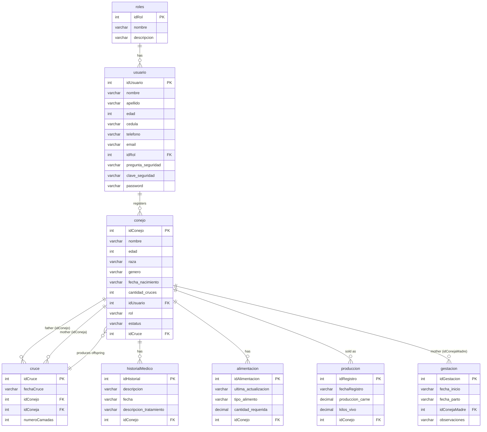

# Sistema Conejos (Rabbit Farm Management System)

## At a glance

| Field           | Value                                                                                                                                                                                                                |
| --------------- | -------------------------------------------------------------------------------------------------------------------------------------------------------------------------------------------------------------------- |
| Type            | Web application, server-rendered native PHP + MySQL, no REST API, no framework                                                                                                                                       |
| Context         | Thesis-level academic project (2023; do not name the university and do not mention grades), based on a real farm in Venezuela (Agro Granja San Jose, Curiepe, Monagas). The farm name may be shown publicly (author) |
| Author's role   | Project leader. Wrote about 77% of the surviving code (see "What the author built")                                                                                                                                  |
| Status          | Finished as an academic deliverable. Deployed for demo purposes only and never used for real by the farm; the case study relies on screenshots only (no demo URL)                                                    |
| Repos           | [Dava2310/SistemaConejos](https://github.com/Dava2310/SistemaConejos) (private)                                                                                                                                      |
| Period          | Git: 2023-06-28 to 2023-08-03 (37 days, 16 active days). "Entrega Preliminar Final" commit on 2023-07-14, features added after it                                                                                    |
| Effort estimate | About 13 hours of commit-based session time (lower bound, see Timeline). No hours stated by the author                                                                                                               |
| Contributors    | Daniel (Dava2310): 20 commits. Gabriel Antuarez (GitHub user GABB1t0): 6 commits (5 real + 1 merge)                                                                                                                  |
| Outcome         | None stated by the author (no grade given)                                                                                                                                                                           |

## Summary

Sistema Conejos is a role-based web system to run a rabbit farm: rabbits and their parentage, medical records, feeding plans, crossings, pregnancies, sales and a printable production report. It was a thesis-level academic team project for a real farm, led by the author, written in plain PHP with MySQL and an object-oriented class layer before he worked with REST APIs. It was demonstrated on a deployed demo but not used in production by the farm.

## The problem and the idea

A real rabbit farm in Venezuela tracked its animals by hand. The idea was one shared database where each worker type (manager, farm hand, veterinarian, administrator) sees only the screens for their job: who is the mother and father of each rabbit, which animals were crossed, which females are pregnant, what each rabbit eats, which treatments it got, and which animals were sold. The owner gets a production report as a PDF. The system records and organises; it does not schedule or recommend anything automatically (author confirmed).

## Impact highlights

Ranked by how credible and impressive they are for a hiring manager.

### 1. Clean class-based data layer in plain PHP (author's pride)

- **What it is:** Every table has its own PHP class (`Usuario`, `Conejo`, `Cruce`, `Gestacion`, `Alimentacion`, `HistorialMedico`, `Produccion`) that owns all of its SQL, plus a singleton `Connection` class. Small endpoint scripts read the request, call a class and answer JSON with an HTTP status. Pages only render.
- **Why it matters:** A clear separation of data access, endpoints and views, built by hand without a framework. All queries are parameterised prepared statements, and each method has PHPDoc.
- **Evidence:** `controllers/clases/*.php` (7 entity classes, about 1,650 lines), `controllers/conexion.php` (singleton `Connection::getInstance()`), 63 `prepare(` calls counted with `grep -c "prepare("` in `controllers/clases/`, 23 endpoint scripts in `controllers/conejos`, `controllers/registros`, `controllers/datos_personales`. About 77 `@param` PHPDoc lines (`grep -c "@param"`).
- **How to say it (EN):** I structured the backend as one PHP class per entity with prepared statements, thin JSON endpoints and view-only pages, without using a framework.
- **ES:** Estructuré el backend con una clase PHP por entidad con consultas preparadas, endpoints JSON delgados y páginas solo de presentación, sin usar un framework.

### 2. Relational model of a breeding farm, with lineage

- **What it is:** An 8-table MySQL schema. The family tree is stored by `conejo.idCruce`, a foreign key to the `cruce` table (which holds the father and the mother). Creating a rabbit from a crossing automatically adds one to that crossing's litter count (`numeroCamadas`), and each crossing adds one to both parents' `cantidad_cruces`.
- **Why it matters:** Parentage, crossings, pregnancies, medical records, feeding and sales all hang from one rabbit table with foreign keys, and a "see parents" screen follows the link to show breed and data of both parents.
- **Evidence:** `baseDatos.sql` (8 tables, 122 lines, with `ALTER TABLE conejo ADD FOREIGN KEY (idCruce)`); `Cruce::agregarCruce` and `Conejo::crearConejo` (counter updates in `conejo.php` lines about 37-80); `Conejo::buscarPadres`, `controllers/conejos/visualizarDatosPadres.php`, `views/pantallasCompartidas/VerCruces.php`. ER diagram in Portfolio material.
- **How to say it (EN):** I designed an 8-table MySQL schema that tracks each rabbit's parents through crossings, with litter and crossing counters kept up to date by the code.
- **ES:** Diseñé un esquema MySQL de 8 tablas que registra los padres de cada conejo mediante cruces, con contadores de camadas y cruces actualizados por el código.

### 3. Production report as a PDF (author's pride)

- **What it is:** A "Reporte de Producción" PDF built with FPDF: farm logo and header (name, location, contact), an orange table header, one row per sale (ID, date, meat kilos, live kilos, rabbit name), page numbers and the print date. Opens in a new tab from the sales page.
- **Why it matters:** It is a real deliverable for the farm owner. A `ReportePDF extends FPDF` class overrides `Header()` and `Footer()` so they repeat on every page, and the rabbit name is joined in per row through `Conejo::conseguirNombre`.
- **Evidence:** `views/fpdf/generar_reporte.php` (120 lines: `ReportePDF`, `TablaContenido`), button in `views/pantallasCompartidas/datosVentas.php`, data from `Produccion::listarProducciones`. Honest note: it lists records, it does not compute totals or filter by date. FPDF itself (`fpdf.php`, 1,934 lines) is a third-party library.
- **How to say it (EN):** I generated a branded production report as a PDF with FPDF, with repeating headers and footers, listing every sale with kilos and rabbit name.
- **ES:** Generé un reporte de producción en PDF con FPDF, con encabezado y pie repetidos en cada página, que lista cada venta con kilos y nombre del conejo.

### 4. Business rules that keep the herd data consistent

- **What it is:** Rules enforced in code: only living males designated "Apareador" and living females can be crossed; only living rabbits can change role or be sold; only rabbits designated "Productor" appear in the sale screen; a sale creates a production record (live kilos, meat kilos, date) and marks the rabbit "Vendido"; a pregnancy cannot start before the female's birth date; email and ID number must be unique.
- **Why it matters:** The status and role of a rabbit act as a small state machine (Vivo/Vendido, role "-", Apareador, Productor) that decides what each screen offers.
- **Evidence:** `Conejo::obtenerTodosLosConejosM` (`genero='Macho' AND estatus='Vivo' AND rol='Apareador'`), `obtenerTodosLasConejas`, `verificarVivo` called by `designarApareador`, `designarSacrificio`, `designarSinRol`, `venderConejo`; `buscarConejosProductor`; `controllers/conejos/vender.php`; `crearGestacion.php` (date check); `Usuario::verificarEmail`, `verificarCedula` and the `...Modificacion` variants.
- **How to say it (EN):** The system enforces herd rules in code, such as who can be crossed, who can be sold and when a pregnancy can start, so records stay consistent.
- **ES:** El sistema aplica reglas del manejo del criadero en el código, como quién puede cruzarse, venderse y cuándo puede iniciar una gestación, para mantener los registros consistentes.

### 5. Four roles with tailored menus and shared screens

- **What it is:** Administrador, Gerente, Jornalero and Veterinario each get their own menu from the same shared pages. Early commits had separate folders per role; they were merged into one `pantallasCompartidas` folder with one menu include per role.
- **Why it matters:** A refactor that removed duplicated pages (about 1,800 lines deleted, 1,100 added in one commit) and left one screen set plus four menu templates.
- **Evidence:** `views/templates/menus/menu{Admin,Gerente,Jornalero,Veterinario}.php`; each page picks the menu by `idRol`; commit `8730b4e` ("organizacion de carpetas", Gabriel).
- **How to say it (EN):** We unified duplicated per-role pages into shared screens with a menu per role, which cut code duplication.
- **ES:** Unificamos las páginas duplicadas por rol en pantallas compartidas con un menú por rol, lo que redujo la duplicación de código.

### 6. Validation on both sides and a consistent JSON/fetch layer

- **What it is:** Client-side validators (Venezuelan phone and ID number formats, name rules, leap-year-aware date check) before any request, then `fetch` calls to JSON endpoints that answer with HTTP status and message.
- **Evidence:** `assets/js/validaciones/validarDatos.js` (298 lines, `validarFecha`, `esBisiesto`, regexes), `validarDatosConejos.js`; 17 JS files in `assets/js`, 14 with `fetch`/jQuery AJAX calls; endpoints like `controllers/registros/crearUsuario.php`.
- **How to say it (EN):** Forms are validated in the browser (including Venezuelan phone and ID formats and leap years) and again on the server where it matters.
- **Thin or not to feature:** the "Tabla de Mejores Razas" in `cruzar.php` is a static list of five breeds (New Zealand, Chinchilla, California, Butterfly, Dutch), taken from the farm owner's advice, so it can be cited as domain input from the owner; it involves no calculation, so do not present it as recommendation logic. The `numeroCamadas` update has no UI to edit it.

## What the author built (role and ownership)

Daniel led the project and, by the numbers, wrote most of the code. Gabriel did the visual layer and three feature modules. The author does not remember who did what, so this comes from the git history only.

| Measure                                                                           | Daniel (Dava2310) | Gabriel (GABB1t0)    |
| --------------------------------------------------------------------------------- | ----------------- | -------------------- |
| Commits                                                                           | 20                | 6 (5 real + 1 merge) |
| Lines surviving at HEAD (`git blame -w -M -C -C`, php/js/css/sql, excluding FPDF) | about 7,141 (77%) | about 2,121 (23%)    |
| Backend classes (`controllers/clases`)                                            | about 1,530 lines | about 330 lines      |
| Endpoints (`controllers/conejos`)                                                 | about 727 lines   | about 145 lines      |
| Client JS (`assets/js`)                                                           | about 2,030 lines | about 250 lines      |
| CSS (`assets/css`)                                                                | 9 lines           | 315 lines            |

Blame is approximate (renames and file moves can mislead; the `-C -C -M` flags were used to follow moves).

**Daniel (by commits):** sessions and login, home pages per role, user creation and editing, rabbit creation and listing, age/email/ID validations, medical record module, user/rabbit management tables, rabbit role designation ("Apareador"/"Productor"), the `Cruce` class, rabbit sales module, gestation creation, validations and menu readjustment, preliminary final delivery, age changes, ID filter, parent details of crossings, email/ID editing, sales data view, breeds table, PDF production report (last commit).

**Gabriel (by commits):** CSS styling of login, home and user management (2023-07-06; 315 CSS lines); folder reorganisation that merged the per-role views into shared pages and added the Veterinario and Jornalero menus (2023-07-09); crossing screen and function plus search bar style (2023-07-11, `cruzar.php`, `cruzar.js`, `VerCruces.php`, `CrearCruce.php`); feeding module (2023-07-12, `alimentacion.php`, `AgregarAlimentacion.php`, `alimentar.js`, endpoints); gestation management module (2023-07-13, `ConsultaGestacion.php`, `ModificarGestacion.js`, `modificarGestacion.php`).

Team: as project leader the author coordinated; Gabriel Antuarez is credited as teammate. No AI assistance is evident in the history (2023 project; none claimed).

## Features

Counted from `views/pantallasCompartidas/` (17 pages), 23 endpoint scripts, 7 entity classes.

**Everyone**

- Login by email and password, PHP session, logout (`controllers/salir.php`). Each page redirects to login if no session.
- Home with personal data; edit own data, with uniqueness checks on email and ID number.

**Rabbits**

- Create (name, breed free text, sex, birth date, age, optional parent crossing), edit, list with search by name and by ID.
- Detail view with parents (breed and data of both).
- Role designation: "-", Apareador (breeding), Productor (shown in the UI as "Sacrificio"/slaughter and sale).
- Medical records (create, edit, list per rabbit): description, date, treatment.
- Feeding plan (feed type, required quantity, last update), with rabbits split into with and without plan.

**Reproduction**

- Crossing: pick one living breeding male and one living female from two tables, creates the crossing with today's date, counters updated. List of crossings with litter counts and a parents detail view.
- Pregnancy: start date, expected birth date (typed by the user), notes, list and edit. No automatic calculation, no breeding recommendation (confirmed). A static "best breeds" priority table is shown on the crossing page.

**Sales and production**

- Sell a rabbit designated Productor: live kilos, meat kilos, date. Rabbit becomes "Vendido". Sales list page. PDF production report.

**Administration**

- User list, create user with role, edit users (`gestionUsuarios.php`, `agregarUsuario.php`, `datosUsuarios.php`).

### What each role can do (from the menus and pages)

The role check is done by `idRol` to choose the menu (1 Administrador, 2 Gerente, 3 Jornalero, otherwise Veterinario). Permissions exist as menu entries; pages only require a logged-in user.

| Screen                          | Administrador | Gerente | Jornalero | Veterinario |
| ------------------------------- | ------------- | ------- | --------- | ----------- |
| Users: manage, create, view     | Yes           | No      | No        | No          |
| Rabbit management (create/edit) | Yes           | No      | Yes       | No          |
| View rabbit data                | Yes           | Yes     | Yes       | Yes         |
| Designate rabbit role           | Yes           | Yes     | Yes       | Yes         |
| Medical records                 | Yes           | No      | Yes       | Yes         |
| Sell rabbits                    | Yes           | Yes     | Yes       | No          |
| Sales data and PDF report       | Yes           | Yes     | Yes       | No          |
| Crossing                        | Yes           | No      | Yes       | Yes         |
| Feeding                         | Yes           | No      | Yes       | Yes         |
| Pregnancy                       | Yes           | No      | Yes       | Yes         |

"Productor" is not a user role: it is a rabbit designation (the earlier question about it is closed). The four user roles are seeded in `baseDatos.sql` (`roles`).

## Tech stack

| Layer    | Technology                                                                                                     | Why it is notable                               |
| -------- | -------------------------------------------------------------------------------------------------------------- | ----------------------------------------------- |
| Frontend | HTML rendered by PHP, vanilla JS (ES modules, `fetch`), jQuery 3.6.0 (CDN, some pages), custom CSS (323 lines) | No framework; per-module JS files               |
| Backend  | Native PHP 7+ (no version declared), `mysqli`                                                                  | Class-per-entity layer, singleton connection    |
| Database | MySQL / MariaDB, schema in `baseDatos.sql`                                                                     | 8 tables with foreign keys, self-linked lineage |
| Reports  | FPDF (bundled, `views/fpdf/`)                                                                                  | Subclassed for header/footer                    |
| Auth     | PHP sessions (`$_SESSION['ID']`)                                                                               | Role looked up per page                         |
| Tooling  | None                                                                                                           | No Composer, Docker, CI or tests                |

Size: about 9,200 lines of PHP/JS/CSS/SQL excluding FPDF (`git ls-files | grep -v fpdf`, then `wc -l`); 17,408 lines in all tracked text files including FPDF.

## Architecture &amp; code practices

**Structure**

- `views/`: pages (`pantallasCompartidas`, `registros/login.php`, `templates/` with head and four menus).
- `controllers/clases/`: 7 entity classes plus `conexion.php` (singleton).
- `controllers/{conejos,registros,datos_personales}/`: JSON endpoints.
- `assets/js/<module>/`: front-end scripts calling those endpoints (AJAX/JSON, no routing layer).
- Typical flow: page -&gt; JS validator -&gt; `fetch` to endpoint -&gt; class method -&gt; prepared statement -&gt; JSON status/message -&gt; alert or page reload.

**Present**

- One class per entity, PHPDoc, singleton DB connection.
- Prepared statements everywhere (63 calls).
- HTTP status codes and JSON messages on endpoints.
- Client validators with regexes; server checks for uniqueness and date consistency.
- Role-based menus and login check on pages.
- Business-rule filters (alive, role, sex) in queries.

**Missing (honest)**

- Relevant to mention as scope/next steps: automated tests, README/setup docs, dependency manager, deployment config. Dates stored as text (`dd/mm/yyyy`), `cruce` declares the foreign key on `idConejo` twice so the mother has no FK (schema bug), age stored beside birth date. The sale (production record plus status change) runs as two statements without a transaction.
- Not for the portfolio (author's rule): see list below.

**Not for the portfolio (author's instructions)**

- Do not present as lessons or copy: the password hashing choice, the lack of output escaping, the lack of role checks on endpoints, hard-coded local database settings, the seed user in the SQL file. Neutral reminder only.

## Timeline &amp; effort

| Measure             | Value                                                                           |
| ------------------- | ------------------------------------------------------------------------------- |
| First / last commit | 2023-06-28 / 2023-08-03                                                         |
| Calendar span       | 37 days, 16 distinct active days                                                |
| Commits             | 26 (Daniel 20, Gabriel 6)                                                       |
| Sessions            | 21 (gap over 3 h starts a new session; session = first to last commit + 30 min) |
| Estimated effort    | About 13.4 h, all authors combined                                              |

The author gave no hour figure. The estimate is a lower bound: only commit times are visible, and several commits are late at night. Story from the history: login and sessions first (06-29), user and rabbit CRUD (06-30 to 07-04), medical records, then crossing, sales, feeding and gestation in a burst on 07-10 to 07-13, validations and the preliminary delivery on 07-13/14, then refinements and the PDF report until 08-03.

## Lessons learned (the author's words, refined)

- As project leader of a thesis-level team project, I learned to split work with a teammate: styling and some modules on one side, core data and logic on the other, and to merge often.
- Building for a real farm taught me to start from the real process (rabbits, parents, crossings, feeding, sales) and turn it into tables before writing screens.
- Organising the PHP code into one class per entity made the system much easier to extend, and I would keep that structure in any language.
- Managing the database (relations, counters, rules by status) was where I learned the most.
- Generating the PDF report showed me how to turn stored data into a document the owner actually uses.
- It was written before I knew REST APIs; moving to proper API design later was a natural next step.

## Portfolio material

**Existing in the repo (no screenshots):** `assets/img/GRANJA ICON.png` (logo, also used in the PDF), `Union.png`, `background-login.png`, `background.png`, `edit-icon.png`, `log-out.png`. No README, demo URL or docs.

**ER diagram (derived from `baseDatos.sql` and the code; the mother FK of `cruce` is drawn as intended, although the SQL declares only the father FK):**

**Draft local setup (inferred from the code; nothing was run):**

1. Install XAMPP (Apache + PHP 7.4 or 8.x + MariaDB) or an equivalent stack. Start Apache and MySQL.
2. Copy the repo folder to `htdocs/SistemaConejos` (so the URL is `http://localhost/SistemaConejos/`).
3. Database config is in `controllers/conexion.php`: `mysqli("localhost:3306", <user>, <password>, "conejos")`. The default XAMPP MySQL user matches it; change the file only if your MySQL uses another user or port.
4. Import `baseDatos.sql` once (phpMyAdmin Import, or `mysql < baseDatos.sql`). Order inside the file is already correct: it drops and creates database `conejos`, then `roles` (4 rows), `usuario`, `conejo`, `historialMedico`, `produccion`, `cruce` (then adds `conejo.idCruce`), `alimentacion`, `gestacion`. Warning: it drops existing data on re-import.
5. Open `http://localhost/SistemaConejos/` (it redirects to `views/registros/login.php`).
6. Log in with the seed administrator in `usuario` (the file inserts one; read its email in phpMyAdmin). The password is stored as an MD5 hash, so if you do not know it, insert a new admin row with `MD5('yourpassword')` in the `password` column and `idRol = 1`. Create one fake user per role from the Administrator screen.
7. If PDF output shows errors, check that no output is sent before the PDF and that `views/fpdf/font/` exists (it does in the repo).

**Screens to capture, with fake data** (create first: 6 rabbits, e.g. 2 males "Rocky", "Max" with role Apareador, 3 females "Luna", "Nube", "Canela", 1 offspring "Bimbo" created from a crossing; one record in medical, feeding and pregnancy; sell 2 Productor rabbits):

1. Login screen.
2. Administrator home (personal data card) and Gerente home (to show the different menus), plus Veterinario menu.
3. "Gestión de Usuarios" list with a user created for each role, and "Agregar usuario" form.
4. "Gestión de Conejos" table with the edit form open on a rabbit.
5. "Seleccionar Rol de Conejos" with one rabbit set as Apareador and one as Productor.
6. "Cruzar": male and female tables with one of each selected, plus the "Tabla de Mejores Razas" visible.
7. "Ver Cruces": crossing list with litter count 1 and the parents detail panel open.
8. "Agregar conejo" for the offspring with the crossing ID filled in.
9. "Registros Clínicos" with a medical record for one rabbit.
10. "Alimentación" with a plan, "Gestación" list with one pregnancy (start and expected birth date).
11. "Vender": sale form for a Productor rabbit (kilos filled), then "Datos de Ventas" with 2 sales.
12. The generated PDF "Reporte de Producción" open in the browser (the farm header can stay; farm name may be shown).
13. Optional: phpMyAdmin Designer view of the 8 tables as an alternative to the Mermaid diagram.

## Draft portfolio copy

**English**

- Kind label: Academic project · 2023
- Name: Sistema Conejos
- One-liner: Role-based PHP and MySQL system for a real rabbit farm: parentage, crossings, feeding, sales and PDF production reports.
- Tags: PHP, MySQL, JavaScript, FPDF, HTML/CSS, Sessions
- Case study outline:
  - **The problem:** A real rabbit farm in Venezuela kept its animal records by hand, so parentage, crossings, pregnancies, feeding, treatments and sales were hard to follow. For my thesis-level project we built a system to keep them in one shared database for each type of worker.
  - **My role:** I led the project and wrote most of the code: the PHP class layer, the database, the rabbit, crossing, sales and medical modules, the validations and the PDF report. A teammate, Gabriel Antuarez, built the styling, the feeding and pregnancy modules and the shared-screen reorganisation.
  - **What I built:** A web app with four roles (administrator, manager, farm hand, veterinarian). It manages rabbits and their parents, medical records, feeding plans, crossings, pregnancies and sales, and generates a production report as a PDF. It was deployed as a demo.
  - **Key decisions:** One PHP class per entity with prepared statements, thin JSON endpoints and view-only pages; an 8-table schema where crossings link parents to offspring and keep litter counters; rules based on status and role (only living, designated rabbits can be crossed or sold); shared screens with a menu per role.
  - **What I learned:** How to lead a small team, to model a real process in a database before building screens, and how structuring code in classes keeps a project manageable. It was written before I used REST APIs.

**Español**

- Etiqueta: Proyecto académico · 2023
- Nombre: Sistema Conejos
- Descripción: Sistema en PHP y MySQL con roles para una granja real de conejos: parentesco, cruces, alimentación, ventas y reportes PDF.
- Tags: PHP, MySQL, JavaScript, FPDF, HTML/CSS, Sesiones
- Esquema del caso de estudio:
  - **El problema:** Una granja de conejos real en Venezuela llevaba sus registros a mano, lo que dificultaba seguir parentesco, cruces, gestaciones, alimentación, tratamientos y ventas. En nuestro proyecto de tesis construimos un sistema que los reúne en una base de datos compartida para cada tipo de trabajador.
  - **Mi rol:** Lideré el proyecto y escribí la mayor parte del código: la capa de clases PHP, la base de datos, los módulos de conejos, cruces, ventas e historial médico, las validaciones y el reporte PDF. Gabriel Antuarez, compañero de equipo, hizo los estilos, los módulos de alimentación y gestación y la reorganización de pantallas compartidas.
  - **Qué construí:** Una aplicación web con cuatro roles (administrador, gerente, jornalero y veterinario). Gestiona conejos y sus padres, historiales médicos, alimentación, cruces, gestaciones y ventas, y genera un reporte de producción en PDF. Se desplegó como demostración.
  - **Decisiones clave:** Una clase PHP por entidad con consultas preparadas, endpoints JSON delgados y páginas solo de presentación; un esquema de 8 tablas donde los cruces enlazan padres con crías y llevan contadores de camadas; reglas según estado y rol (solo conejos vivos y designados pueden cruzarse o venderse); pantallas compartidas con un menú por rol.
  - **Qué aprendí:** A liderar un equipo pequeño, a modelar un proceso real en una base de datos antes de construir pantallas y cómo estructurar el código en clases mantiene el proyecto manejable. Lo escribí antes de usar APIs REST.

## Not for the portfolio (author's instructions)

- Do not name the university, and do not mention any grade or evaluator comment.
- Do not present the security limitations (MD5 passwords, input escaping, missing endpoint authorization) as lessons or features, and do not mention the demo database credentials.
- No live demo link: use screenshots only.
